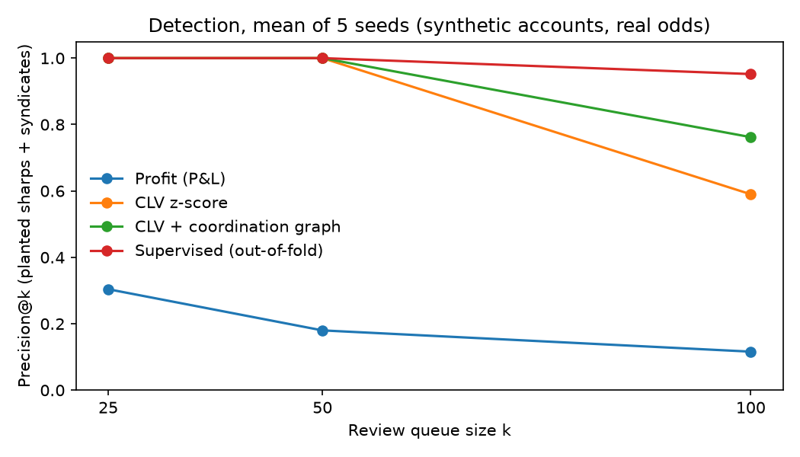
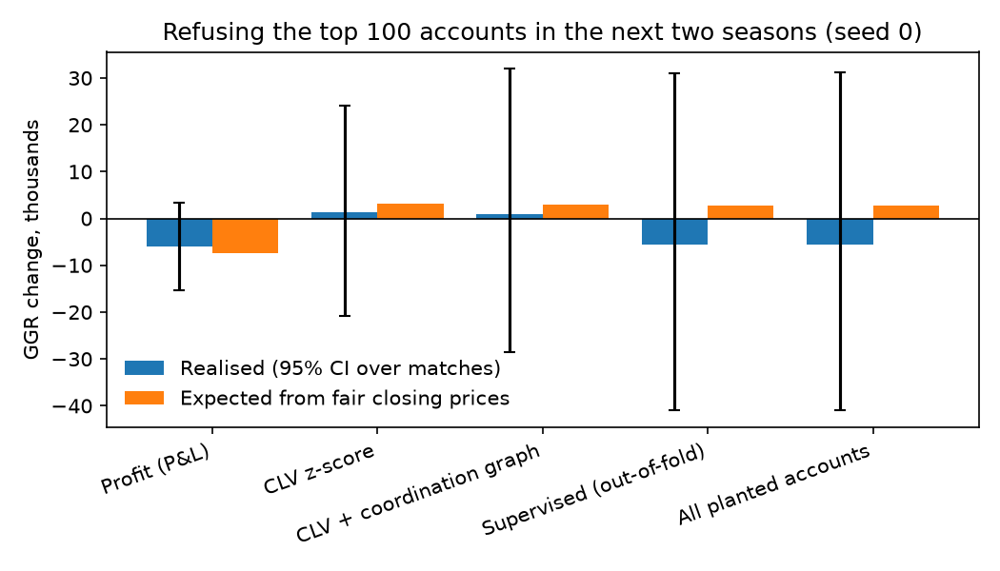

# Sportsbook Customer-Risk and Syndicate Detection

Finding the accounts that beat a sportsbook (sharp bettors and coordinated
syndicates) from their bet history, ranking them into a trader review queue,
and measuring what restricting them is worth to the book.

> **The accounts and bets are synthetic. The prices and results are real.**
> Bet flow is simulated on 1,508 real Premier League matches (2021/22 to
> 2024/25) using real Bet365 and Pinnacle odds from
> [football-data.co.uk](https://www.football-data.co.uk/). Whether a bet beat
> the closing line therefore comes from real line movement, but who placed it,
> and why, is made up. All detection numbers below are against planted
> accounts and are not evidence about any real customer base.

## Results

Detection runs on 2021/22–2022/23. Restriction is applied to the flagged
accounts and measured on 2023/24–2024/25, so the GGR figures are out-of-time.
Each figure is the mean over 5 simulation seeds (sd in brackets); each seed
has about 4,300 accounts, 91–100 of them planted, and about 440,000 bets.

### Who gets found

| Ranking | Precision@25 | Precision@50 | Precision@100 | Recall@100 |
|---|---|---|---|---|
| Profit (P&L) | 0.30 (0.07) | 0.18 (0.06) | 0.12 (0.05) | 0.12 (0.05) |
| CLV z-score | 1.00 (0.00) | 1.00 (0.00) | 0.59 (0.06) | 0.62 (0.08) |
| CLV + coordination graph | 1.00 (0.00) | 1.00 (0.00) | 0.76 (0.07) | 0.80 (0.09) |
| Supervised (out-of-fold) | 1.00 (0.00) | 1.00 (0.00) | 0.95 (0.03) | 1.00 (0.00) |



- **Profit finds lucky recreational bettors, not sharps.** Over two seasons,
  result variance swamps a small edge: across the 5 seeds the planted sharps'
  median CLV was +0.1% to +1.2%, yet their median ROI in the detection seasons
  was −9.4% to −13.5%.
- **The coordination graph recovered all 10 planted syndicates as
  communities in every seed**, and kept all 5 tipster-follower groups apart
  from them. Followers bet together too, but their co-bets lose the full
  margin (in seed 0, group CLV z −60 to −75), while syndicates' co-bets beat
  the close (up to +12.7). Pooling a group's co-bets is what finds members
  whose own record is diluted by recreational-style bets: individually their
  median CLV z-score is −0.14 to +1.5 across seeds, below the z = 2 a trader
  would act on.
- **The supervised model needs labels.** Here they come from the simulation;
  in practice they would come from trader-reviewed cases. The CLV and graph
  scores need none.

At a review threshold of CLV z ≥ 2 rather than a fixed k:

| Score | Accounts flagged | Precision | Recall | Expected GGR change | Turnover refused |
|---|---|---|---|---|---|
| CLV z-score | 33.0 (4.6) | 1.00 (0.00) | 0.35 (0.06) | +3,115 (637) | 3.1% |
| CLV + coordination graph | 58.8 (6.0) | 1.00 (0.00) | 0.62 (0.08) | +3,360 (728) | 5.2% |

### What restricting them is worth

Refusing every bet the top-100 accounts place in the following two seasons
(book GGR over those seasons: 160,577 units on average):

| Ranking | Expected GGR change | Realised GGR change | Turnover refused |
|---|---|---|---|
| Profit (P&L) | −7,480 (781) | −6,005 (2,606) | 5.8% |
| CLV z-score | +3,770 (634) | −4,589 (9,254) | 5.9% |
| CLV + coordination graph | +3,701 (755) | −6,259 (10,432) | 7.4% |
| Supervised (out-of-fold) | +3,136 (1,005) | −11,696 (10,752) | 10.6% |
| All planted accounts | +3,112 (1,096) | −12,069 (11,030) | 10.6% |



- **Restricting by profit costs the book money**: about −7,500 expected
  (−4.7% of GGR), because it refuses recreational accounts the book profits
  from.
- **Restricting by CLV gains about +3,700 expected, roughly +2.3% of GGR.**
  Ranking by CLV gains more than refusing every planted account, because some
  planted accounts have no real edge and their other bets are profitable.
- **The realised change cannot be measured on two seasons of results.** For
  seed 0 the 95% bootstrap interval over matches for the CLV + graph
  restriction is −28,494 to +31,934, against an expected +3,007. The seeds
  share the same real results, so their spread understates this uncertainty.
  I checked that this is variance, not bias: on the selections informed
  accounts backed, actual wins match the fair closing probabilities in every
  seed (|z| ≤ 0.7). This is why the expected (closing-line) measure is the one
  to manage by.

## How it works

**Prices** (`src/sbrisk/odds.py`). The book offers Bet365's prices, moving
linearly in implied probability from the opening to the closing odds over the
96 hours before kickoff. The fair probability is Pinnacle's closing price with
the margin removed. A bet's closing-line value is `price × fair probability −
1`. Markets: 1X2 and over/under 2.5 goals. 2025/26 is excluded because
Pinnacle closing odds are missing for 170 of its 380 matches.

**Accounts** (`src/sbrisk/simulate.py`).

| Group | Behaviour | Label |
|---|---|---|
| Recreational (4,000) | Bets close to kickoff, favours favourites, no information | 0 |
| Tipster followers (5 groups of 30–60) | Copy a tipster's pick within minutes: coordinated, no edge | 0 |
| Sharps (40) | Noisy estimate of the fair closing price; bet 36–96 h out when the price beats it by 2% | 1 |
| Syndicates (10 groups of 3–8) | One shared estimate; members place it within 5 minutes of each other | 1 |

Sharps and syndicate members also place recreational-style bets. Informed
bettors act early because that is where the real edge is: 96 hours out, 46% of
matches have a selection priced more than 2% above the fair close; at 24 hours,
4.6%.

**Detection** (`features.py`, `graph.py`, `detect.py`). Per-account CLV
z-score; a coordination graph joining accounts that back the same selection
within 10 minutes (at least 5 times, at least 10% of the smaller account's
bets), split into Louvain communities, each scored by the CLV z-score of its
co-bets; a review queue with the evidence for each account
(`reports/review_queue_seed0.csv`).

**Evaluation** (`evaluate.py`). Precision and recall at k against the planted
accounts; GGR change from refusing flagged accounts in the next period,
realised (with a bootstrap over matches) and expected from fair closing
prices.

## Limits

- Synthetic accounts: real syndicates spread bets over more accounts, books
  and time, and real coordination is much noisier than here, so the graph's
  clean recovery and the zero false positives at z ≥ 2 are best cases.
- Two price snapshots per match; the path between them is assumed linear.
- The book is a price-taker against Bet365's prices; it does not move its own
  line in response to sharp money, so the value of that signal is not counted.
- Restriction means refusing all bets. Stake limits scale the effect roughly
  linearly. Lost recreational turnover from restricted accounts is counted;
  the wider commercial cost of restricting customers is not.

## Run it

```bash
python -m venv venv
venv/Scripts/pip install -r requirements.txt     # Windows; venv/bin/pip elsewhere
venv/Scripts/python scripts/run_experiment.py    # downloads the CSVs, ~20 s for 5 seeds
venv/Scripts/python -m pytest -q
```

Outputs: `reports/results.json` (every metric, per seed and summarised),
`reports/review_queue_seed0.csv`, `reports/figures/`.
